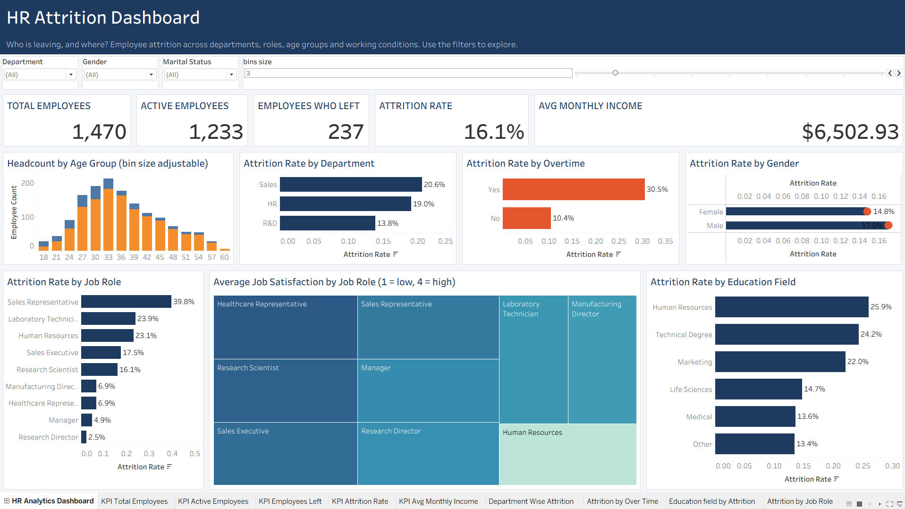

# HR Attrition Dashboard (Tableau)

An interactive Tableau dashboard analysing employee attrition across
departments, job roles, age groups and working conditions.

## Business question
Who is leaving the company, and what factors are linked to attrition?

## Data
Sample HR dataset (1,470 employees, 39 columns). Source: [name it here].
This is a sample dataset, not real company data.

## Key insights
- Overall attrition is 16.1% (237 of 1,470 employees).
- Employees who work overtime leave at 30.5% vs 10.4% for those who don't.
- Sales Representatives have the highest attrition (39.8%).
- Employees under 25 have the highest attrition by age band (39.2%).

## Features
- KPI cards: total, active and departed employees, attrition rate, average monthly income
- Filters for department, gender and marital status
- Adjustable age bin size

## How to open
Download `HR_Dashboard.twbx` and open it in Tableau Desktop.

## Tools
Tableau, Excel
